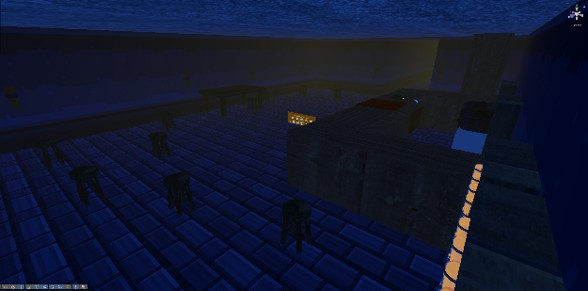
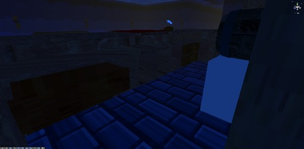
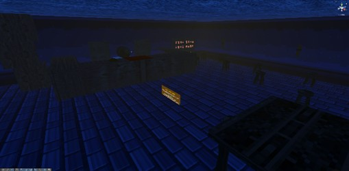

Beers Shop

Genre: Arcade / Casual
Project Type: Collaborative Academic Project

Overview

Beers Shop is an arcade-style game set in a bar where the player takes the role of a bartender. The main gameplay revolves around serving beer mugs to rats that appear throughout the game.

Project Information

Engine: Unity

Programming Language: C#

Development Context: University project

Team: Collaborative development

My Contribution

Individual responsibilities and contributions will be documented here.

Development Highlights

Gameplay mechanics, design decisions, and development details will be added as they are documented.

Media

Credits

This project was developed collaboratively. Team members and their respective contributions will be credited here.

Project documentation by Giovanna Gutiérrez.
